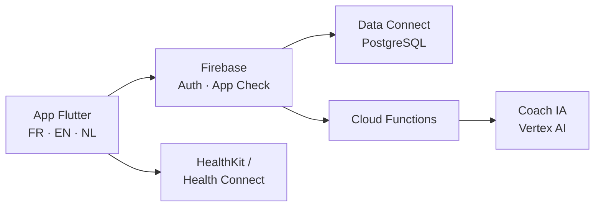

# LAB Longevity

Application mobile de bien-être et de longévité, conçue et développée pendant
mon stage Erasmus au **LAB Antwerp** (Anvers, mai – juillet 2026).

> Ce dépôt est une vitrine. Le code source appartient au projet et reste privé.

## Le problème

Les personnes qui suivent de près leur forme jonglent avec une dizaine
d'applications différentes : une pour la nutrition, une pour l'entraînement,
une pour le sommeil, une pour la récupération. LAB Longevity réunit tout cela
au même endroit.

## L'application

- **Trois modules qui se recoupent** : nutrition, récupération, entraînement.
  Ils partagent un même modèle de données, parce que ce qu'on mange influence
  la récupération, et la récupération l'entraînement suivant.
- **Connectée aux données de santé du téléphone** : Apple HealthKit sur iOS,
  Google Health Connect sur Android.
- **Un coach intelligent** qui transforme ces données en conseils concrets.
- **Trilingue dès la conception** : français, anglais, néerlandais.

## Stack

| | |
|---|---|
| Application | Flutter, Dart |
| Back-end | Firebase : Authentication, Data Connect (PostgreSQL), Cloud Functions, App Check |
| Données santé | Apple HealthKit, Google Health Connect |
| IA | Vertex AI |
| Travail d'équipe | Git, GitHub, Figma |

## L'équipe et mon rôle

Nous étions **six étudiants**, avec de vraies échéances et de vrais
utilisateurs en ligne de mire. **J'avais le lead du projet** : conception,
modélisation des données et développement.

Le projet a aussi demandé de la rigueur sur ce qui ne se voit pas : gestion
des erreurs, confidentialité des données de santé (RGPD), tests et code
documenté.

## En savoir plus

- [Mon portfolio](https://titouanfleurent-portfolio.netlify.app/flight), page parcours
- [Mon LinkedIn](https://www.linkedin.com/in/titouan-fleurent-merad-61032a291)
